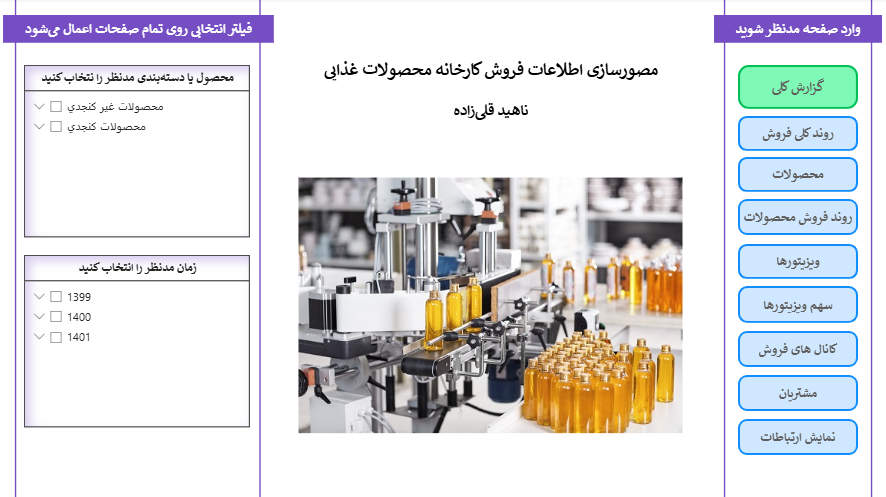

# Food Manufacturing Sales Data Analysis & Visualization

## 📌 Project Overview
This project involves a comprehensive analysis and visualization of sales data for a food manufacturing company covering the years 1399 to 1401. The primary objective is to evaluate sales performance, identify key trends, and provide actionable insights to support strategic decision-making. 

The analysis explores various dimensions, including financial value (Net Sales), sales volume (Quantity), and product weight, across different timeframes, product categories, sales channels, and top-performing sales representatives.

This project delivers insights through two distinct formats:
1.  **Detailed Analytical Report:** Created using **JMP**, this report provides an in-depth exploratory data analysis (EDA) with granular visualizations of sales trends and patterns.
2.  **Executive Management Dashboards:** Developed using **Power BI**, providing two separate interactive views. Notably, this includes a dedicated **Senior Executive Dashboard**, specifically designed for the CEO, summarizing key performance indicators (KPIs) and critical insights into a concise, two-page layout for quick, high-level decision-making.

## 🛠️ Tools & Technologies
- **JMP Software:** Used for detailed statistical analysis and generating comprehensive visualization reports.
- **Power BI:** Utilized for building interactive, high-level management dashboards.
- **Data Transformation:** Converting Gregorian dates to the Solar Hijri calendar for localized analysis.

## 📂 Dataset
The dataset contains transactional sales data spanning three years (1399-1401) and includes:
- **Temporal Data:** Invoice dates (converted to Solar calendar: Year, Quarter, Month, Day, Weekday).
- **Product Details:** Product IDs, Names, multi-level categorizations (Levels 1, 2, and 3), unit types, and net weights.
- **Sales Metrics (KPIs):** Net Sales Value (`TotalNetSales`), Total Quantity Sold (`TotalQuant`), and Total Weight Sold (`TotalWeight`).
- **Entity Information:** Customer IDs, Customer Names, and Sales Representative (Visitor) Names.
- **Sales Channels:** Multi-level sales channel categorizations (e.g., B2B, Website, SnappFood, Basalam, In-store).

## 📊 Results & Insights
The analysis revealed several key findings:



1.  **Inflation vs. Real Growth:** While total *Net Sales (Value)* showed a steep upward trend across the three years, *Total Quantity* and *Total Weight* sold experienced a decline in the final year (1401). This indicates that the apparent revenue growth was largely driven by price inflation rather than an increase in business volume.
2.  **Seasonal Demand:** Sales consistently perform better in the second half of the year (Fall and Winter). This aligns with the product portfolio, which heavily features "warm-natured" foods (like sesame products and syrups) that are more popular in colder seasons.
3.  **Monthly & Daily Patterns:** 
    - March (Esfand) consistently records the highest sales, likely due to year-end promotions or campaigns. April (Farvardin) sees the lowest sales.
    - Fridays are the weakest days for sales across the week.
4.  **Top Performing Products:** Sesame-based products (specifically Tahini/Ardeh) dominate the top 10 best-selling items. Among non-sesame products, Grape Syrup is the highest earner.
5.  **Sales Representatives' Performance:** "Zahra Zare" significantly outperformed other representatives over the three years, generating almost three times the sales of her closest competitor. However, the gap narrowed in 1401 as other reps improved their performance.
6.  **Sales Channels:** **B2B** is the dominant sales channel. In the online segment, direct Website sales significantly outperform third-party platforms like Basalam and SnappFood, though platform preferences showed shifts between 1400 and 1401.

## 📁 Repository Structure
- `Visualization.xlsx`: The raw dataset used for the analysis.
- `Food-Factory-Analysis.pdf`: The detailed exploratory data analysis and visualization report generated using JMP.
- `PowerBI-Dashboard.pbix`: Analytics Dashboard for Mid-Level Managers.
- `PowerBI-Dashboard(Senior).pbix`: Key Performance Indicators Dashboard for CEOs.

```text
Food-Factory-Analysis-Using-JMP&PowerBI/
│
├── Charts/
│   ├── ...
│   └── ...
│
├── data/
│   └── Visualization.xlsx
│
├── PowerBI/
│   ├── PowerBI-Dashboard(Senior).pbix
│   └── PowerBI-Dashboard.pbix
│
├── Report/
│   └── Food-Factory-Analysis.pdf
│
└── README.md
```

## 💻 How to Use
1.  Clone this repository or download the files.
2.  Review the `Food-Factory-Analysis.pdf` for an in-depth understanding of the data trends and patterns.
3.  Open the associated Power BI files to interact with the executive dashboards and explore the high-level summaries designed for management.